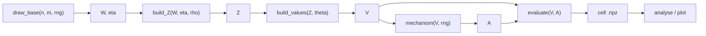

# EF1/EFX Round-Robin Simulation

Simulation code for the bachelor thesis *The Gap Between EF1 and EFX:
A Simulation-Based Average-Case Analysis of Round-Robin*.

## Pipeline

One path for every mechanism:



`draw_base` → `build_Z` → `build_values(Z, theta)` → `A = mechanism(V, rng)` → `evaluate(V, A)`.

v1 default is `round_robin`. The slot is `mechanism(V, rng) -> A`. Also registered:
`uniform_random_balanced` (size-matched null model), `efx_optimum` (brute-force enumeration).
In `main.py`, set `MECHANISM = round_robin` or `uniform_random_balanced` for the same
4-page overview PDF.

Optional brute-force compare (only when `n >= 4`): set `ENUMERATE = 1` in `main.py`. Default is off. Enumeration runs on the main cell only, paired with Round Robin on the same `V`.

## Setup

```bash
python3 -m venv .venv
.venv/bin/pip install -r requirements.txt
```

Entry scripts (`main.py`, `stage9_aggregate.py`, …) re-exec with `.venv/bin/python`
when that file exists. If the venv is missing or broken, they keep using the
interpreter you started with (often system Python) — create `.venv` as above for
reproducible deps.

## How to run

### Fixed `(n, m)` overview

1. Open `main.py` and edit `N`, `M`, `R`, and `MECHANISM`.
2. `./main.py`
3. Opens nothing: PDF on disk under `figures/n{N}_m{M}_R{R}_seed{SEED}/` (4 pages for that `m`). Cells in the matching `results/` folder.

### Aggregated landscape (hypotheses H1/H2/H4)

1. Open `stage9_aggregate.py` and set `MECHANISM` to `round_robin` or
   `uniform_random_balanced`, plus `THETA_FIXED` (run θ = 0.1, 0.25, 0.5, 0.75, 1.0, 1.5
   one after another). Edit `R` if needed (default grids: `n=2..5`, `m=n+1..4n`, `ρ`-grid).
2. `./stage9_aggregate.py`
3. One shared folder `results/aggregate_R{R}_seed{SEED}/` (mechanism name is in each
   `.npz`; RR and null do not overwrite). PDF under `figures/aggregate_…/` named with
   mechanism and θ — m-sweep pages for each `n`, then n-sweep at fixed `m/n` (default 2).
   Also `aggregate_summary_{mechanism}_theta….csv`.

### Paired RR vs mechanism X (aggregate)

1. After RR and X cells exist (Stage 9 twice, or once each), open
   `stage10_compare.py` (`MECHANISM_A = round_robin`, `MECHANISM_B` = X;
   optional `THETA_PLOT`, `M_OVER_N`).
2. `./stage10_compare.py`
3. Writes `comparison_{A}_vs_{B}.csv` in the aggregate results folder and an
   8-page Compare-PDF under `figures/aggregate_…/` (EFX overlay, Δ, a_only/b_only,
   n-/θ-sweeps, ρ=1 anchor, paired tables at `m/n` for each `n`).

Literature certificates live in `stage0_theory.py` and appear as columns in
cell summaries (`certificate`, `pr_exists_lower_bound`, `pr_rr_efx_given_exists`).

Uses `.venv/bin/python` when `.venv` exists; otherwise the current interpreter (see Setup).

Sanity checks:

```bash
# prefer the project venv when present
.venv/bin/python stage8_test_sanity.py
# or: python3 stage8_test_sanity.py
```

Findings note (aggregate R=2000 lemma / claim discipline):
`docs/FINDINGS_aggregate_R2000.md`.

## Modules

Files are numbered in pipeline order. `main.py` stays the entry point.

| File | Role |
|---|---|
| `stage0_theory.py` | Literature EFX-existence certificates (S1–S4, ORDERED) |
| `stage1_sampling.py` | `draw_base` → `build_Z` → `build_values` |
| `stage2_mechanisms.py` | Plug-in slot; `round_robin`, `uniform_random_balanced`, `efx_optimum` |
| `stage3_evaluate.py` | Uncapped `alpha` matrix, `alpha_star`, EF1/EFX checks |
| `stage4_simulate.py` | `run_cell`, `.npz` I/O, `reconstruct` from `(master_seed, k)` |
| `stage5_analyse.py` | Survival, EFX rate, `compare_cells`, certificates in `summarise_cell` |
| `stage6_scales.py` | Labels: `theta` with Gini, `rho` with Spearman |
| `stage7_plot.py` | Fixed-m overview + aggregate / sweep PDF helpers |
| `stage8_test_sanity.py` | Sanity tests C–F, N, G/H, P/Q/R/S |
| `stage9_aggregate.py` | Full `(n,m,ρ)` grid + aggregate PDF; RR or null (H1/H2/H4) |
| `stage10_compare.py` | Paired RR vs X CSV + Compare-PDF over the aggregate grid |
| `main.py` | Fixed `(n, m)` overview run |

## Notes

- Cell parameters `n`, `m`, `rho`, `theta` are free (with `n >= 2`, `m > n`, `rho in [0,1]`, `theta > 0`).
- Filenames use `rho{rho:.2f}_theta{theta:.2f}` via `cell_filename` only.
- Plot legends show both `rho`/`theta` and Spearman/Gini.
- Fairness tolerance `eps` is an analysis argument only (default `0.0`).
